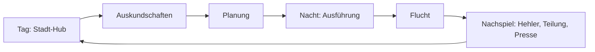

# 02 – Game Design

## 1. Kernloop

Ein Coup dauert 45–90 Minuten Spielzeit. Zwischen zwei Coups liegen 1–3 Spieltage im Hub.

| Phase | Spieler-Fantasie | Kernaktion |
|---|---|---|
| Tag | „Ich kenne die richtigen Leute.“ | Kontakte, Crew, Ausrüstung, Tipps |
| Auskundschaften | „Ich sehe, was andere übersehen.“ | Informationen sammeln, Grundriss aufdecken |
| Planung | „Ich bin der Kopf.“ | Zeitleiste bauen, Geisterlauf testen |
| Ausführung | „Jetzt zeigt sich, ob ich recht hatte.“ | Zuschauen, pausieren, eingreifen |
| Nachspiel | „Hat es sich gelohnt?“ | Verkaufen, teilen, Konsequenzen tragen |

## 2. Stadt-Hub (Tag)

- **Ein Stadtviertel** (Hafen, Altstadt, Geschäftsviertel) als begehbare, aber kompakte Top-down-Karte.
  Kein Open World – Orte werden angeklickt, kurze Laufwege, Tageszeit läuft in Schritten (Vormittag,
  Nachmittag, Abend).
- **Orte:** Stammkneipe (Crew-Rekrutierung, Gerüchte), Hehler, Werkzeughändler, Schrottplatz (Fluchtwagen),
  Bibliothek/Bauamt (Grundrisse), Telefonzelle (Kontakte anrufen), eigenes Versteck (Planungstisch, Lager).
- **Aktionen kosten Zeit**, und jeder Tag ohne Coup kostet Geld (Miete, Schulden, Crew-Unterhalt).
  Das erzeugt sanften Druck, ohne zu hetzen.

## 3. Crew

Jedes Crewmitglied ist eine handgeschriebene Figur (~10 in der Kampagne, max. 4 pro Coup).

**Fähigkeiten (0–5):** Schlösser, Elektrik, Tresore, Kraft, Fahren, Leisetreten, Reden (Ablenkung/Täuschung).

**Persönlichkeit:**
- *Loyalität* – steigt mit fairer Bezahlung und Erfolg, sinkt bei Streit oder Pleiten.
- *Gier* – bestimmt den geforderten Anteil.
- *Nerven* – Wahrscheinlichkeit, bei Alarm in Panik zu geraten oder vom Plan abzuweichen.
- *Eigenart* – 1–2 Traits, z. B. „Kettenraucher“ (Geruch/Licht, aber ruhiger), „Plaudertasche“
  (Gerüchte über die Crew verbreiten sich), „Perfektionist“ (langsamer, aber fehlerfrei).

**Beziehungen:** Einfache Sympathie-Matrix zwischen Crewmitgliedern. Zwei, die sich hassen, arbeiten
schlechter zusammen (längere Synchronisations-Wartezeiten, Streit im Funk).

**Konsequenzen:** Verhaftete Crewmitglieder können auspacken (Fahndungsdruck auf den Spieler steigt),
können freigekauft werden (Anwalt) oder kommen Wochen später verbittert zurück.

## 4. Ausrüstung

~25 Werkzeuge in drei Stufen. Jedes Werkzeug hat: **Dauer**, **Lautstärke**, **benötigte Fähigkeit**,
**Gewicht** (Tragekapazität), **Spuren** (erhöht Fahndungsdruck).

| Kategorie | Beispiele |
|---|---|
| Einstieg | Dietrich-Set, Glasschneider, Brecheisen, Leiter, Bohrmaschine |
| Elektrik | Seitenschneider, Überbrückungskabel, Multimeter (Alarmtyp erkennen) |
| Tresor | Stethoskop, Bohrgerät, Schneidbrenner, Sprengstoff (laut!) |
| Transport | Seesack, Sackkarre, Kleintransporter |
| Ablenkung | Feuerwerkskörper, Telefonanruf, Verkleidung (Handwerker, Polizist) |

## 5. Objekte (Kampagne)

8–10 handgebaute Objekte mit steigender Komplexität:

1. Tabakladen (Tutorial: Tür, ein Alarm, keine Wache)
2. Pfandhaus (erste Wache mit fester Route)
3. Villa am Stadtrand (Hund, Familie schläft oben)
4. Juwelier *(Vertical Slice)* – zwei Wachen, Lichtschranke, Wandtresor
5. Lagerhaus am Hafen (große Beute, schwerer Abtransport)
6. Pelz- und Kunsthandel (Beute ist sperrig und schwer zu verkaufen)
7. Hotel mit Hotelsafe (Gäste, Nachtportier, Täuschung)
8. Stadtmuseum (mehrere Stockwerke, wechselnde Wachschichten)
9. Privatbank (Zeitschloss-Tresor)
10. Zentralbank (Finale, mehrstufiger Coup über zwei Nächte)

Jedes Objekt hat **Varianten** durch Wochentag, Wetter und Wachdienst-Schichtplan – Wiederspielwert ohne
prozedurale Level.

## 6. Auskundschaften

Der Grundriss ist anfangs nur grob bekannt („Nebel des Krieges“). Informationen kommen aus:

- **Begehung bei Tag** als Kunde (Innenräume, Personal, sichtbare Tresore) – kostet Zeit, erhöht
  Wiedererkennungsrisiko.
- **Beobachtung bei Nacht** vom Auto aus (Wachrouten, Lichtzeiten, Patrouillen der Polizei).
- **Bauamt** (vollständiger Grundriss, aber veraltet: Umbauten fehlen).
- **Kontakte** (Ex-Mitarbeiter, Putzkolonne) – kosten Geld oder Gefallen, manchmal falsche Infos.

Nur aufgedeckte Informationen fließen in den Geisterlauf ein. **Unbekanntes wird im Planer sichtbar
markiert** („Raum nicht erkundet – Simulation unsicher“).

## 7. Der Planer

Das wichtigste UI des Spiels.

- **Puppenhaus-Ansicht** des Objekts, Stockwerke einzeln einblendbar.
- **Zeitleiste** unten: eine Spur pro Crewmitglied + eine Spur „Fahrzeug“. Sekundengenau, zoombar.
- **Aktionen** werden per Klick auf Objekte in der Welt gesetzt („Gehe zu“, „Öffne Tür mit Dietrich“,
  „Schneide Kabel“, „Warte auf Signal“) und landen als Block mit Dauer auf der Zeitleiste.
- **Synchronisation:** „Warte, bis Ganove B Alarm abgeschaltet hat“ – Abhängigkeitspfeile zwischen Spuren.
- **Lärm-Overlay:** Jede Aktion zeigt ihren Lärmradius; Wachen in Hörweite werden markiert.
- **Geisterlauf:** Ein Klick simuliert den Plan im Zeitraffer mit dem aktuellen Wissensstand.
  Konflikte (gesehen, gehört, Tür noch zu) werden rot auf der Zeitleiste markiert.
- **Undo/Redo, Varianten speichern**, Plan-Vorlagen.

Ziel: Ein erfahrener Spieler plant den Juwelier in 10–15 Minuten.

## 8. Ausführung (Nacht)

- Der Plan läuft in **Echtzeit** (1×, 2×, 4×, Pause).
- Der Spieler kann **jederzeit pausieren und eingreifen**: Aktion abbrechen, umplanen, Crewmitglied
  direkt steuern (Klick-to-move), Ablenkung zünden.
- **Abweichungen** vom Plan (Wache bleibt stehen, unbekannte Tür ist verschlossen) werden als Warnung
  angezeigt; die Zeitleiste „verbiegt“ sich sichtbar.
- **Alarm:** Startet einen Countdown bis zum Eintreffen der Polizei, abhängig von Alarmtyp, Uhrzeit
  und Entfernung zum Revier. Jetzt zählt nur noch Flucht.
- **Nerven:** Bei Alarm würfelt jedes Crewmitglied gegen seine Nerven – Panik bedeutet: lässt Beute fallen,
  rennt los, schreit.
- **Flucht:** Mit dem Fahrzeug über eine Mini-Stadtkarte; Straßensperren ab einem gewissen Fahndungsstand.

## 9. Polizei & Fahndung

- **Fahndungsdruck (0–100)** steigt durch Spuren (Werkzeug, Zeugen, Fingerabdrücke, verhaftete Crew,
  auffälliges Ausgeben von Geld) und sinkt langsam mit der Zeit.
- Effekte: mehr Polizeistreifen nachts, schnellere Reaktionszeit, Razzien im Versteck, Hehler zahlt weniger.
- **Zeitungen** berichten nach jedem Coup – narrative Rückmeldung und Hinweis auf gemachte Fehler.

## 10. Hehler & Wirtschaft

- Mehrere Hehler mit unterschiedlichen Spezialgebieten (Schmuck, Kunst, Elektronik) und Preisen.
- Preis = Basiswert × Hehler-Spezialisierung × (1 – Fahndungsdruck-Faktor) × Verhandlungsergebnis.
- **Verhandlung** als kurzes Dialogspiel (Bluff, Geduld, Drohen) – eine Runde, kein Minispiel-Grind.
- **Beuteteilung:** Der Spieler legt die Anteile fest; Abweichungen von den Forderungen beeinflussen Loyalität.
- Geldsenken: Ausrüstung, Fahrzeuge, Informanten, Anwalt, Miete, Bestechung.

## 11. Progression

- **Ruf** in der Unterwelt schaltet bessere Crew, Hehler und Tipps frei.
- **Crewmitglieder lernen** durch Einsätze (+1 Fähigkeit bei erfolgreichen Spezialaktionen).
- **Versteck-Upgrades:** besserer Planungstisch (mehr Geisterläufe), Werkstatt (eigene Werkzeuge), Garage.
- Kein Skill-Tree für den Spieler selbst – der Spieler *ist* der Planer; seine Progression ist Können.

## 12. Story-Gerüst

- Drei Akte über ~10 Coups. Der Spieler kommt mit Schulden bei einem Kredithai aus dem Gefängnis;
  der Weg führt über die Unterwelt zur Frage, wer eigentlich hinter der Zentralbank-Sache steckt.
- Erzählt in kurzen, vertonten Szenen im Hub (statische Kameras, Porträts), Zeitungsartikeln und
  Funkgesprächen während der Coups.
- Ein bis zwei Wendepunkte sind von Crew-Entscheidungen abhängig (wer verrät wen).

## 13. Beispiel-Coup: Juwelier „Brandauer & Söhne“ (Vertical Slice)

**Bekannt nach Auskundschaften:** Hintereingang mit Sicherheitsschloss, Alarmkasten im Keller,
Lichtschranke im Verkaufsraum, Wandtresor im Büro (Kombinationsschloss), zwei Wachen: eine im Laden
(Runde alle 6 Minuten), eine im Wachhäuschen gegenüber (Blick auf den Vordereingang).

**Crew:** Spieler-Figur (Planer, fährt), Elektrikerin, Tresorknacker.

| Zeit | Fahrer | Elektrikerin | Tresorknacker |
|---|---|---|---|
| 02:00 | Parkt in der Seitengasse | Steigt aus | Steigt aus |
| 02:01 | Wartet | Öffnet Hintertür (Dietrich, 40 s) | Wartet an der Tür |
| 02:02 | Wartet | Keller: überbrückt Alarm (90 s, leise) | Wartet auf Signal „Alarm aus“ |
| 02:04 | Wartet | Deaktiviert Lichtschranke | Schleicht ins Büro (Wache ist im Vorraum) |
| 02:05 | Wartet | Hält Wache, Funk | Knackt Tresor (Stethoskop, 4 min) |
| 02:09 | Fährt vor | Rückzug | Leert Tresor, Rückzug |
| 02:10 | Abfahrt | – | – |

**Was schiefgehen kann:** Die Ladenwache unterbricht ihre Runde (Trait „unruhig“), der Tresorknacker hat
schlechte Nerven, im Keller steht ein unbekannter zweiter Alarmkasten (wer das Bauamt nicht besucht hat,
weiß das nicht).

## 14. Schwierigkeit & Zugänglichkeit

- Schwierigkeitsgrade verändern Polizeireaktionszeit, Anzahl Geisterläufe und Hehlerpreise – nicht die KI-Regeln.
- Optionale Hilfen: Wachrouten immer sichtbar, unbegrenzte Geisterläufe, „Zurückspulen“ während der Ausführung.
- Komplett mit Maus spielbar, Tastenkürzel für alles, Controller-Support für Steam Deck.
- Farbenblind-Modi für Sicht- und Lärm-Overlays, skalierbare UI-Schrift.
