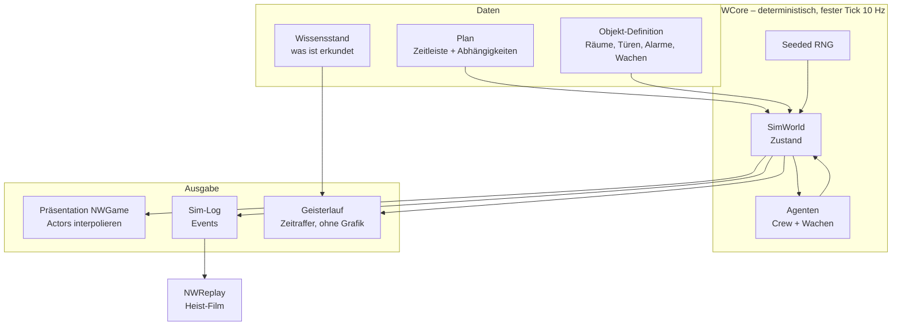

# 03 – Technik (Unreal Engine 5)

## Grundsätze

- **Engine-Version zu Projektbeginn fixieren** (aktuelle stabile UE5-Version) und nur bei klarem
  Nutzen zwischen Meilensteinen upgraden – nie während eines Meilensteins.
- **C++ für Systeme, Blueprints für Content.** Alles, was simuliert, gespeichert oder getestet werden
  muss, liegt in C++. Blueprints konfigurieren, verdrahten und präsentieren.
- **Daten statt Code:** Crew, Werkzeuge, Objekte, Hehler als `UPrimaryDataAsset` / DataTables.
- **Zielplattform:** PC (DX12), Steam Deck. 60 fps @ 1440p auf einer Mittelklasse-GPU, 30–40 fps auf Steam Deck
  mit reduziertem Profil.

## Modulstruktur

| Modul | Aufgabe |
|---|---|
| `NWCore` | Deterministische Simulation: Welt-Zustand, Agenten, Wahrnehmung, Türen, Alarme, Zufall |
| `NWPlanning` | Plan-Datenmodell, Zeitleiste, Abhängigkeiten, Geisterlauf, Validierung |
| `NWGame` | Präsentation: Actors, Animation, Kamera, Licht, VFX, Audio-Trigger |
| `NWUI` | CommonUI-Screens, Planer-Zeitleiste, Hub-Menüs |
| `NWReplay` | Aufzeichnung des Sim-Logs, Kamera-Regeln, Sequencer-Generierung |
| `NWEditor` | Editor-Tools: Objekt-Validierung, Wachrouten-Editor, Debug-Visualisierung |

## Die wichtigste Entscheidung: Simulation getrennt von Darstellung

- Die Simulation läuft in **reinem C++ ohne Abhängigkeit von Actors oder Physik**, mit festem Tick
  (z. B. 10 Hz) und eigenem, gesätem Zufallsgenerator.
- Positionen in festen Einheiten (z. B. Zentimeter als `int32` auf einem Navigationsgraphen), damit
  Gleitkomma-Rundung den Determinismus nicht bricht.
- Die Darstellung (`NWGame`) liest nur den Sim-Zustand und **interpoliert** Positionen/Animationen dazwischen.
- Vorteile:
  - **Geisterlauf:** gleiche Simulation, 100× schneller, ohne Rendering.
  - **Replay:** Plan + Seed + Spielereingriffe reichen, um alles exakt nachzuspielen.
  - **Speichern** mitten im Coup trivial (Sim-Zustand serialisieren).
  - **Automatisierte Tests:** Pläne als Testfälle („dieser Plan muss den Juwelier lösen“).

## Navigation

- Pro Objekt wird beim Cook/Editor-Build aus dem UE-NavMesh ein **vereinfachter Wegpunkt-Graph** erzeugt
  (Räume, Türen als Kanten mit Zustand). Die Simulation pfadet auf diesem Graphen (A*).
- Die Präsentation nutzt den Graph-Pfad und glättet ihn für die Bewegung der Figuren.

## KI der Wachen

- **StateTree** für das Verhaltensmodell (Patrouille, Pause, Misstrauen, Untersuchen, Alarm, Verfolgen).
  Die StateTree-Logik ruft ausschließlich deterministische Sim-Funktionen auf.
- **Eigene Wahrnehmung** statt UE AI Perception: Sichtkegel (Winkel, Reichweite, Lichtstärke im Raum),
  Hörradius mit Dämpfung durch Wände/Türen. Ergebnisse sind diskret (nicht gesehen / Verdacht / gesehen).
- **Lesbarkeit vor Realismus:** Jeder Zustandswechsel hat ein klares Signal (Fragezeichen, Taschenlampe
  schwenkt, Funkspruch).

## Interaktionen

- Türen, Fenster, Tresore, Alarmkästen, Lichtschalter als **Smart Objects** mit **Gameplay Tags**
  (`Door.Locked.Security`, `Alarm.Contact`, `Safe.Combination`).
- Werkzeug-Aktionen als **schlankes eigenes Aktionssystem** in `NWCore` (Dauer, Lärm, Voraussetzungen,
  Ergebnis). GAS ist für ein deterministisches Einzelspieler-Tick-System überdimensioniert.

## Kamera

- Top-down-Orbit-Kamera (Spring Arm), Zoom in 3 Stufen, Rotation in 45°/90°-Schritten oder frei.
- **Puppenhaus-Effekt:** Wände zwischen Kamera und Fokus blenden per **Material Parameter Collection**
  + Dither-Fade aus; obere Stockwerke werden per Schnittebene ausgeblendet.
- Fokus-Modus: Doppelklick auf Crewmitglied folgt ihm sanft.

## Rendering

- **Lumen** für globale Beleuchtung und Reflexionen – nasse Straßen und Lampenlicht sind der Look.
- **Nanite** für Umgebungsgeometrie, **Virtual Shadow Maps**.
- **PCG-Framework** für Stadt-Dressing (Mülltonnen, Laternen, Plakate, geparkte Autos) im Hub und um die Objekte.
- Skalierbarkeitsprofile: Hoch (Lumen HW-RT), Mittel (Lumen SW), Deck (reduzierte Lumen-Qualität, TSR 50–60 %).
- Post-Process: leichte Filmkörnung, Bloom, Tilt-Shift-Unschärfe optional (Miniatur-Look).

## Animation

- Basis: **Motion Matching** mit dem Game Animation Sample von Epic als Startpunkt, ergänzt durch
  eigene Interaktions-Animationen (Schloss knacken, Kabel schneiden, Tresor öffnen) über **Motion Warping**.
- Aus der Top-down-Distanz reichen stilisierte Charaktere; **MetaHuman** nur für Porträts und
  Nahaufnahmen im Replay/Dialog.
- Mocap optional günstig über Video-Mocap-Dienste oder ein gemietetes Studio für 1–2 Tage.

## UI

- **CommonUI + UMG** (Eingabe-Routing für Maus und Controller).
- **Planer-Zeitleiste** als eigenes C++-Widget (Slate oder UMG-Custom), weil Performance und präzises
  Drag & Drop entscheidend sind.
- Weltmarkierungen (Sicht-, Lärm-Overlays) als Decals/Instanced Meshes, nicht als UMG.

## Replay / Heist-Film

1. Während der Ausführung schreibt `NWCore` ein **Event-Log** (Tür geöffnet, Alarm, Wache misstrauisch, Beute genommen).
2. `NWReplay` bewertet Events nach Dramatik und wählt 60–120 Sekunden aus.
3. Regelbasierte **Kamerawahl** (Nahaufnahme bei Tresor, Split-Screen bei parallelen Aktionen,
   Weitwinkel bei Flucht) erzeugt zur Laufzeit eine **Level Sequence** (Sequencer).
4. Musik-Stems werden nach Spannungskurve gemischt.
5. Export als Video über **Movie Render Queue** (Editor) bzw. In-Game-Aufnahme/Steam-Recording.

## Speichern

- `USaveGame` mit versionierten Strukturen; Kampagnenstand, Crew, Wirtschaft, laufender Coup (Sim-Zustand).
- Autosave vor jedem Coup und bei Tageswechsel.

## Audio

- **MetaSounds** für Lärm-reaktive Klänge (Schritte je Untergrund, Werkzeuge), Quartz für taktgenaue
  Musik-Übergänge, Sound-Klassen/Submixe für Dialog, Musik, Effekte.

## Tests & Qualität

- **Automation Tests** für `NWCore` (Determinismus: gleicher Seed + Plan → identischer Hash des Endzustands).
- **Referenz-Pläne pro Objekt** als Regressionstest (jedes Objekt muss lösbar bleiben).
- Gauntlet/Commandlet-Läufe in CI nachts.
- Telemetrie (opt-in) in Beta: wo scheitern Pläne, wie lange dauert Planung.

## Build & CI

- Lokale Builds über UnrealBuildTool; CI mit einem eigenen Build-Rechner (z. B. GitHub Actions
  Self-hosted Runner oder Jenkins/TeamCity), weil Cloud-Runner für UE-Builds zu klein sind.
- Nightly: Compile, Automation Tests, Cook für Win64, Upload als Steam-Beta-Branch.
